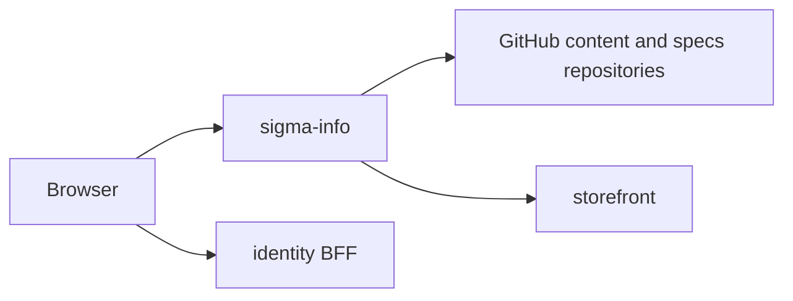

# sigma-info architecture

`sigma-info` is the public information and product-specification site. Browsers reach it directly through the platform gateway; it links to the storefront, the identity BFF, contact, and cart services through the theme chrome.

## Context

This service owns no database: its health routes are registered without a pool.

## Runtime shape

The `sigma-info` binary hands `sigma_info::routes()` to `sigma_theme::warp::run_service`, which builds the multithreaded Tokio runtime and serves until shutdown. The theme crate supplies the Warp server, termination behaviour, shared static assets, themed error recovery, security headers, and the listen address from `PORT`.

The process is otherwise stateless. It caches rendered landing HTML, remote information documents, and SIGMA-RACER specifications in process memory. `content::docs()` uses a one-hour TTL cache with stale-on-error behaviour; `specs::sigma_racer_specs()` uses the independently configured specification TTL.

## Request flow

`routes()` combines the cached `index_page()` at `GET /`, `doc_page()` at `GET /doc/{slug}`, and `sigma_racer_page()` at `GET /products/sigma-racer`. `sigma_theme::warp::site_routes` also supplies `/up`, `/health`, `/static/*`, and `/favicon.ico`.

`doc_page()` calls `content::docs()`, resolves the requested slug with `content::get()`, and renders it with `templates::render_doc_html()`. Remote Markdown is fetched from GitHub and converted to HTML; `content/terms.md` is embedded as an offline fallback. `sigma_racer_page()` fetches root Markdown from the configured specs repository, filters non-specification documents, orders tabs, and renders `templates::render_sigma_racer_html()`.

## Code map

| Path | Responsibility |
| --- | --- |
| `src/main.rs` | Names the service and hands its routes to the theme's `run_service`. |
| `src/lib.rs` | Assembles site, health, theme, CSP, and rejection routes. |
| `src/config.rs` | Reads public URL, GitHub repository, ref, path, and cache configuration. |
| `src/content.rs` and `src/content/doc_entry.rs` | Fetch, cache, parse, sort, and look up information documents. |
| `src/specs.rs`, `src/specs/spec_source.rs`, and `src/specs/spec_document_view.rs` | Fetch, filter, order, and render SIGMA-RACER specification documents. |
| `src/templates.rs` and `src/templates/*.rs` | Build Askama template data, shared site chrome, navigation, breadcrumbs, and cards. |
| `templates/*.html` | Askama HTML templates for the index, documents, and specification tabs. |

## Data

This service is stateless and owns no PostgreSQL schema or tables. Remote Markdown and HTML are held only in process-local TTL caches; a restart discards them.

## Configuration

| Environment variable | Purpose |
| --- | --- |
| `PORT` | Listen port supplied to the theme crate. |
| `INFO_PUBLIC_BASE_URL` | Public base URL used in the shared chrome. |
| `INFO_IDENTITY_PUBLIC_URL` | identity BFF URL used for navigation and CSP `connect-src`. |
| `INFO_CONTACT_PUBLIC_URL` | Contact-service URL used by the shared chrome. |
| `INFO_CART_PUBLIC_URL` | Cart-service URL used by the shared chrome. |
| `INFO_STORE_PUBLIC_URL` | Storefront base URL used by SIGMA-RACER breadcrumbs and product links. |
| `INFO_CONTENT_REPO` | GitHub `owner/name` repository for information documents. |
| `INFO_CONTENT_PATH` | Directory within the content repository to list. |
| `INFO_CONTENT_REF` | Git ref used for information documents. |
| `INFO_CONTENT_CACHE_TTL_SECS` | Information-document cache lifetime; defaults to one hour. |
| `INFO_RACER_SPECS_REPO` | GitHub `owner/name` repository for SIGMA-RACER specifications. |
| `INFO_RACER_SPECS_REF` | Git ref used for specifications. |
| `INFO_RACER_SPECS_CACHE_TTL_SECS` | Specification cache lifetime; defaults to 1,800 seconds. |

## Deployment

`Dockerfile` produces the `sigma-info` image. The platform deployment is at `../platform/services/info/base/deployment.yaml`; it exposes container port `8080` through `../platform/services/info/base/service.yaml` on service port `80`. Both probes currently request `GET /`, although `/up` and `/health` are also available.

The public VirtualService and environment overlays reside beside the base manifests under `../platform/services/info/`. Production hostname and platform context are documented in [`../platform/README.md`](../platform/README.md).

## Testing

Run `cargo test`. Unit tests cover front-matter parsing, built-in Terms fallback, document ordering, spec filename filtering and ordering, the main pages, unknown-document `404`, and `GET /up`.

## Design notes

- Content is fetched at request time rather than read from a writable runtime volume; the built-in Terms document keeps the site usable when GitHub is unavailable.
- Remote results use single-flight TTL caches with graceful fallback, reducing GitHub API traffic and avoiding an upstream outage becoming a site error.
- The theme crate owns common HTML chrome, embedded static assets, security headers, and health-route integration.
- Specification tabs deliberately exclude repository policy and contribution files, preserving only product-build documents in the customer-facing view.
